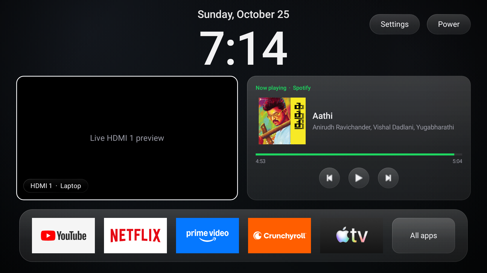

# TV Home — debloat + liquid-glass launcher for a Sony BRAVIA Android TV

A faster, ad-free Sony BRAVIA Android TV with a custom home screen, built entirely over network ADB
from a Windows PC. Nothing is rooted, nothing is uninstalled, and every change can be undone.


<sub>The home screen as the launcher renders it. On the TV the left tile shows the laptop's HDMI input live.</sub>

- **Debloat** — switches off ads, tracking, telemetry, demo and hotel-mode services (`pm disable-user`,
  reversible). App logins and data are never touched.
- **Custom launcher** — liquid-glass home screen: a centered iOS-style 12-hour clock, a **live HDMI
  preview tile** (OK = full screen, Back = shrink), a **Now playing** panel for Spotify or any media
  app, and a glass app dock. Focus pops tiles forward with a ring that's visible on white banners too.
- **Remote shortcuts** (hold a number key, from any app):
  - **0** — HDMI full screen
  - **1 / 2 / 3** — "desktops": one app each, switched back exactly where you left it
  - **4** (on a desktop) — that desktop's app tray: swap its app or close it
  - **Home** — always straight to the home screen
- **Welcome / signing-out screens** — "Welcome, *name*" on every power-on; a Power button on the home
  screen shows "Signing out, *name*" and puts the TV in standby.
- **TV audio to the PC** — turns a Windows PC into a Bluetooth speaker for the TV, so TV sound mixes
  with the PC's audio in the PC's headphones.

Plain Java, no Gradle, no third-party libraries; the launcher uses about 40 MB of RAM.

## Tested hardware

| | |
|---|---|
| TV | Sony KD-55X8000H (BRAVIA 4K UR3, 2020) |
| OS | Android TV 10 (API 29), stock Sony firmware |
| SoC | MediaTek MT5893, `armeabi-v7a` |
| RAM / storage | 2.2 GB / ~6 GB user data |
| UI | 1920×1080 at 320 dpi (960×540 dp) |
| Inputs | 4× HDMI (HDMI 3 = ARC) |
| PC | Windows 11, PowerShell 5.1 |

Other Sony Android TVs (2018–2021, Android 8–10, classic `com.google.android.tvlauncher` home)
should behave the same; package names in `debloat.txt` can differ by model, so check `status` first.
Google TV models (the newer `launcherx` home screen) are **not** covered.

## Setup

### On the TV
1. Settings → Device Preferences → About → press **Build** 7 times to enable Developer options.
2. Developer options → turn on **USB debugging** (this X8000H opens network ADB on port 5555 with it).
3. Note the TV's IP address (Settings → Network & Internet).

### On the PC (no admin rights needed)
1. **adb**: unzip [Android platform-tools](https://developer.android.com/tools/releases/platform-tools)
   into `%USERPROFILE%\platform-tools` (or put `adb` on PATH).
2. **JDK 17**: unzip e.g. [Temurin 17](https://adoptium.net/) into `%USERPROFILE%\jdk\` (or set `JAVA_HOME`).
3. **Android SDK**: platform `android-34` and build-tools `34.0.0` in `%LOCALAPPDATA%\Android\Sdk`
   (or set `ANDROID_HOME`). Only `android.jar`, `aapt2`, `d8`, `zipalign` and `apksigner` are used.

### Tell the scripts where your TV is
Your TV's address is personal and is **never** stored in the repo. Either:
```powershell
Set-Content .tvhost '<tv-ip>:5555'      # local file, git-ignored
$env:TV_HOST = '<tv-ip>:5555'           # or for this session
.\tv.ps1 check -TvHost <tv-ip>          # or per command
```
The first connection shows **"Allow USB debugging?"** on the TV — tick *Always allow* and press OK.
Every script refuses to continue unless the TV reports the expected model (`-Model`, default
`KD-55X8000H`), so a second TV on the same network is never touched.

## Usage

### Debloat — `tv.ps1` + `debloat.txt`
```powershell
.\tv.ps1 status     # what's on / off
.\tv.ps1 apply      # disable everything in debloat.txt
.\tv.ps1 restore    # undo
```
`debloat.txt` lists each package with the reason it's off, and the ones kept on purpose
(voice search, AirPlay, Chromecast, DLNA, set-top-box control…). **Keep `com.vewd.core.service`
enabled** — Sony's AirPlay crash-loops without it.

### Launcher — `tv-home.ps1`
```powershell
.\tv-home.ps1 install -OwnerName "Your Name"   # build, install, make it Home (name is optional, remembered locally)
.\tv-home.ps1 check                            # which app is Home
.\tv-home.ps1 rollback                         # stock home screen back (launcher stays installed)
.\tv-home.ps1 uninstall
```
`install` grants the Now playing panel media access, enables the shortcut accessibility service, and
rolls back automatically if Home doesn't land on the new launcher.

Change the dock apps, the previewed HDMI input and its label in
[`launcher/src/dev/tvhome/launcher/Config.java`](launcher/src/dev/tvhome/launcher/Config.java), then run `install` again.
Desktops can also be set over adb:
`adb shell am start -n dev.tvhome.launcher/.HomeActivity --es dev.tvhome.launcher.SET_DESKTOP 1:com.google.android.youtube.tv`

### TV audio to the PC — `tv-audio-receiver.ps1`
1. Set the PC's sound output to your headphones (not the TV, or audio loops).
2. Pair from the **PC**: Settings → Bluetooth & devices → Add device, while the TV is on
   Settings → Remotes & Accessories. (Pairing started only from the TV leaves Windows without a record.)
3. `.\tv-audio-receiver.ps1 -List` to check the TV shows up, then either run it once
   (`.\tv-audio-receiver.ps1 -Name SONY`) or install it to start hidden at every sign-in:
   `.\tv-audio-receiver.ps1 -InstallTask` (current user, no admin; `-RemoveTask` undoes it).
   It keeps a receiving connection ready, retries while the TV is off, and logs changes to
   `%LOCALAPPDATA%\TRG-TV\tv-audio-receiver.log`.
4. If the laptop can't open the link itself (log says `Waiting for the TV (UnknownFailure)`), connect from
   the TV once: Settings → Remotes & Accessories → your PC → Connect.

While connected the TV's own speakers are silent. Uses Windows' built-in `AudioPlaybackConnection`
(A2DP sink) — nothing to install. ~0.2 s Bluetooth latency.

## What this Sony firmware does and doesn't allow

Learned the hard way; worth knowing before changing anything:

- **The stock home screen wins.** `com.google.android.tvlauncher` declares HOME priority 2, which beats
  any user-chosen Home, and Android 10 won't let adb disable a single component. The whole package is
  disabled instead (reversible).
- **No multi-window.** Freeform, split screen and task resizing are all refused, and
  `persist.sys.debug.multi_window` can't be set. A 50/50 "tiling" mode built on the developer
  "simulated secondary display" worked but was fragile (fixed translucent window, mirroring when empty,
  DRM apps black, focus stealing) and was removed in favour of desktops.
- **Unused digit keys go to Sony's TV app** (`com.sony.dtv.tvx`), which jumps to the TV input with a
  channel number. The shortcut service therefore swallows 0–4 and times holds itself (swallowed keys get
  no auto-repeat); a quick tap types the digit into a focused text field instead.
- **Apps can't end other apps** (`killBackgroundProcesses` → "Invalid packageName"), so "Close" empties a
  desktop and Android drops the app from its cache when it needs memory.
- **HDMI preview works for third-party apps** via `TvView` passthrough; Sony's input service doesn't
  report the signal size, so set the source to 16:9 (e.g. 1920×1080) to avoid pillarboxing.
- **Right after boot** the launcher starts before Sony's HDMI service registers its inputs; it retries.
- **Boot logo / boot animation** are in read-only firmware and can't be replaced without root; the
  remote's power button is handled before apps see it, so the goodbye screen comes only from the
  launcher's Power button.
- **No live blur** (Android 12+), so the liquid glass is a pre-blurred aurora plus translucent panels.
- Keys injected with `adb shell input` **bypass accessibility services** — test shortcuts with a real remote.

## Project layout

```
tv.ps1 / debloat.txt        debloat: status / apply / restore
tv-home.ps1                 launcher: install / check / rollback / uninstall
tv-common.ps1               shared: TV address, adb, model check
build-apk.ps1               plain-Java app -> signed APK (aapt2, javac, d8, apksigner)
tv-audio-receiver.ps1       Windows A2DP sink for TV audio
launcher/                   the home screen app (dev.tvhome.launcher)
  src/.../HomeActivity      layout, HDMI tile, app tray / desktop picker
  src/.../KeyService        accessibility service: shortcuts, Home, greetings
  src/.../NowPlayingPanel   media-session panel
  src/.../Glass, Ui         liquid-glass drawables, focus effect, helpers
  src/.../Config            dock apps, HDMI input, music app
hdmi-test/                  minimal app that checks TvView HDMI preview works on a TV
docs/tv-home-screen.png     README screenshot
```

To refresh the screenshot: `adb shell am start -n dev.tvhome.launcher/.HomeActivity --ez dev.tvhome.launcher.SNAPSHOT true`,
then `adb pull /sdcard/Android/data/dev.tvhome.launcher/files/home.png docs/tv-home-screen.png`. The launcher draws itself
(this TV's `screencap` is empty while the HDMI layer is on screen). By default Now playing is shown idle;
add `--ez dev.tvhome.launcher.SNAPSHOT_KEEP_MUSIC true` to keep the current track, as in the screenshot above.

## Security & privacy

- Network debugging lets anything on your network control the TV. Turn it off when you're not changing
  things; turn it on again to run the scripts.
- `.tvhost`, `.owner-name`, the signing key (`*.keystore`), build output and any `baseline/` snapshots
  of your TV are git-ignored. Keep it that way: they identify your network, your name and your apps.
- `build-apk.ps1` creates a local debug signing key on first build. It isn't a secret worth protecting
  for personal use, but don't publish it.

## License

MIT — see [LICENSE](LICENSE).
